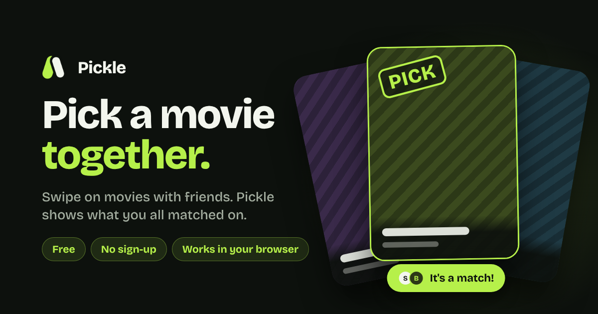

# Pickle 🥒
 
**Pick a movie, together or on your own.** Swipe through a deck of movies picked for your mood. With friends, Pickle shows what you all said yes to. Solo, it's a quick way to find something you actually want to watch. No more scrolling for an hour.
 
**Try it:** [pickle-movies.web.app](https://pickle-movies.web.app). Free, no sign-up, works in the browser on your phone or laptop.


 
## How it works
 
**With friends**
1. **Start a room** and send your friends the link or the 6-letter code (up to 10 people).
2. **Everyone picks a genre** (up to 2 each). A "Not tonight" veto removes a genre for the whole group.
3. **Swipe** through a deck of 20 movies built from everyone's picks: right to pick, left to pass.
4. **See your matches**, the movies everyone picked, best first. Can't decide? **Pick for us** spins and chooses one for the whole room.

**Solo**
1. Tap **swipe solo**, pick up to 2 genres (or "Surprise me").
2. Swipe through 20 movies matched to your taste.
3. Your picks become your shortlist, and **Pick for us** chooses one if you can't decide.


## Features
 
- **Phone or laptop.** Runs in any browser, nothing to install. Swipe with your finger, or drag with the mouse and use the buttons.
- **Live rooms.** Everyone's progress, genre picks and the final pick update instantly on every phone.
- **Smart decks.** Mixes everyone's genres fairly and skips movies anyone in the room has already seen. Uses a short taste quiz to match how much of a film buff you are.
- **Flip a card for details:** a trailer preview (with a scrubbable progress bar), cast, genres and where to stream it.
- **"I've already seen it"** swaps in a fresh card for the whole group, highlighted in green so everyone knows why the deck grew.
- **Undo** a swipe, plus a short swipe and flip tutorial on your first visit.
- **Saved matches.** Every night's matches are kept, and you can tick off the ones you've watched.
- **Secure.** Anonymous sign-in with Firestore security rules: you can only change your own profile and rooms you're in. Rooms delete themselves after 24 hours.

## Tech stack
 
| | |
|---|---|
| App | React Native + Expo (Expo Router), TypeScript, React Native Web |
| Backend | Firebase: Cloud Firestore (real-time sync), Anonymous Auth, Hosting |
| Data | [TMDB API](https://www.themoviedb.org/) for movies, YouTube embeds for trailers |

## Run it locally
 
```bash
cd mobile-app
npm install
```
 
Create `mobile-app/.env`:
 
```
EXPO_PUBLIC_TMDB_API_KEY=your_tmdb_key
EXPO_PUBLIC_FIREBASE_API_KEY=...
EXPO_PUBLIC_FIREBASE_AUTH_DOMAIN=...
EXPO_PUBLIC_FIREBASE_PROJECT_ID=...
EXPO_PUBLIC_FIREBASE_STORAGE_BUCKET=...
EXPO_PUBLIC_FIREBASE_MESSAGING_SENDER_ID=...
EXPO_PUBLIC_FIREBASE_APP_ID=...
```
 
In your Firebase project, turn on Firestore and **Anonymous** sign-in, then:
 
```bash
npx expo start --web
```
 
## Project structure
 
```
mobile-app/
  src/app/                 entry point and screen flow
  src/components/screens/  one file per screen (lobby, genres, swipe, results, saved…)
  src/lib/                 rooms (Firestore), TMDB, sign-in, saved matches
  public/                  page template and link preview image
prototype/                 the first version: a Python command-line prototype
```
 
---
 
Movie data from [TMDB](https://www.themoviedb.org/). This product uses the TMDB API but is not endorsed or certified by TMDB.
 
Made by [Viktoriia Kychan](https://www.linkedin.com/in/viktoriia-kychan/).